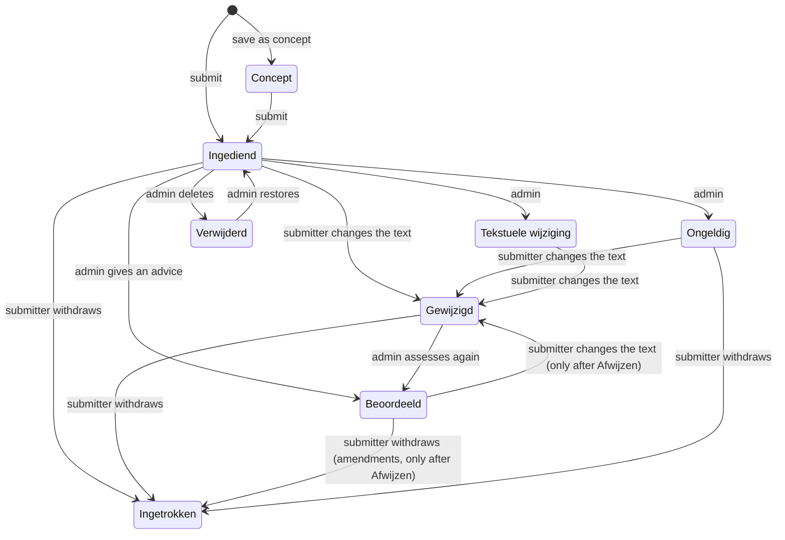

# Statuses of a proposal

Every amendment (*wijzigingsvoorstel*) and motion (*motie*) has one status.
This page describes what each status means, who moves a proposal from one
status to the next, and what is still possible in each status.

*Admins* are users with the permission to manage all amendments and motions
(the secretariat). *Submitter* (*hoofdindiener*) is the afdeling that submitted
the proposal; *co-submitters* (*mede-indieners*) are afdelingen that joined it
later.

The mails described below are sent by default. Users with the permission
`administer ammo mail settings` can switch each one off at
`/admin/ammo/mail-settings` (*E-mailinstellingen*), or switch all of them off
at once.

## The flow

Admins can set any status (except Verwijderd) on the **status/advies** form at
any time until the meeting starts, so the diagram shows the usual route, not
every possible one.

## The statuses

| Status | Meaning | Who sees it |
| --- | --- | --- |
| **Concept** | Saved but not yet submitted. | Admins and the owners of the proposal. |
| **Ingediend** | Submitted, waiting for an assessment. | Everyone who can view proposals. |
| **Gewijzigd** | The submitter changed the text after submitting; waiting for a new assessment. | Everyone who can view proposals. |
| **Beoordeeld** | Assessed. The advice gives the outcome: *Overnemen* or *Afwijzen*. | Everyone who can view proposals. |
| **Ingetrokken** | Withdrawn. Shown folded in. | Everyone who can view proposals. |
| **Ongeldig** | Not valid. Amendments are shown folded in. | Everyone who can view proposals. |
| **Tekstuele wijziging** | A change in spelling or grammar only. | Everyone who can view proposals. |
| **Verwijderd** | Deleted by an admin. | Admins only. |

A meeting can hide statuses and advice from regular users. Concept,
Ingetrokken and (for amendments) Ongeldig are always shown.

## Step by step

### 1. Concept

An afdeling starts a proposal and can save it as a concept. It can keep
changing the concept while the submission period (*Indienen*) of the meeting is
open. Only its owners and admins see it.

### 2. Ingediend

When the afdeling submits the proposal it gets the status **Ingediend**, and
the afdeling gets a confirmation mail. While a proposal is Ingediend:

- other afdelingen can **co-submit** it (*mede indienen*); this is only possible
  in this status;
- members can support it;
- the submitter can **change** it while the change period (*Wijzigen*) of the
  meeting is open (see Gewijzigd);
- the submitter can **withdraw** it, and co-submitters can leave it, until the
  *Uiterste intrek/ondersteuningsdatum*.

### 3. Gewijzigd

When the submitter changes a submitted proposal, only the text and the
explanation (*toelichting*) can change; the number and location stay the same.
The proposal gets the status **Gewijzigd** and keeps its previous advice. The
secretariat and all owner afdelingen, co-submitters included, get a mail with
the differences.

A Gewijzigd proposal cannot be changed again until an admin has assessed it
again. Other afdelingen cannot co-submit it.

### 4. Beoordeeld

An admin assesses the proposal on the **status/advies** form. The status
Beoordeeld always needs an advice:

- **Overnemen** (accept): the proposal is final. Its afdelingen can no longer
  change or withdraw it. Only afdelingen that did not (co-)submit it can request
  a vote.
- **Afwijzen** (reject): the submitter can still change it (it becomes
  Gewijzigd) while the change period is open. Any afdeling can request a vote.
  A rejected amendment can still be withdrawn but gets no new member support. A
  rejected motion is shown folded in and can no longer be withdrawn by its
  afdelingen.

The secretariat and the owner afdelingen get a mail when the status or advice
changes, unless the meeting hides it. A vote can be requested (*stemming aanvragen*) on the statuses chosen under
**Stemmingaanvraag instellingen**; by default that is only Beoordeeld.

### 5. Other statuses

- **Ingetrokken**: the submitter withdrew the proposal (also when it has
  co-submitters), or the last owner left it. It is shown folded in, and
  afdelingen can do nothing more with it.
- **Ongeldig**: set by an admin. It can no longer be co-submitted, and an
  amendment gets no new member support. The submitter can still withdraw it,
  or change it while the change period is open (it then becomes Gewijzigd).
- **Tekstuele wijziging**: set by an admin for a change in spelling or grammar
  only. Afdelingen can no longer withdraw or co-submit it. The submitter can
  still change it while the change period is open (it then becomes
  Gewijzigd).
- **Verwijderd**: an admin deletes the proposal with the **Verwijderen** button
  and an explanation, which is mailed to the owners. Only admins still see it.
  Choosing another status on status/advies restores it.

## Deadlines

| Deadline | What it closes |
| --- | --- |
| *Indienen* period | Submitting new proposals and changing concepts. |
| *Wijzigen* period | Changing submitted proposals by the submitter. |
| *Uiterste intrek/ondersteuningsdatum* (end of that day) | Withdrawing, co-submitting, leaving as co-submitter, member support and vote requests. |
| Meeting date | The status/advies form. |

Admins are not bound by the *Indienen* and *Wijzigen* periods, and can still
handle vote requests after the *Uiterste intrek/ondersteuningsdatum*.
